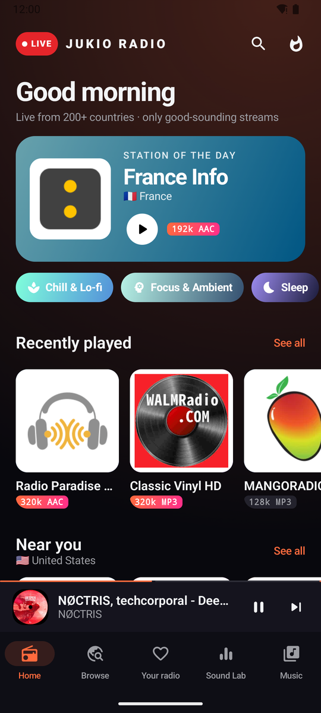
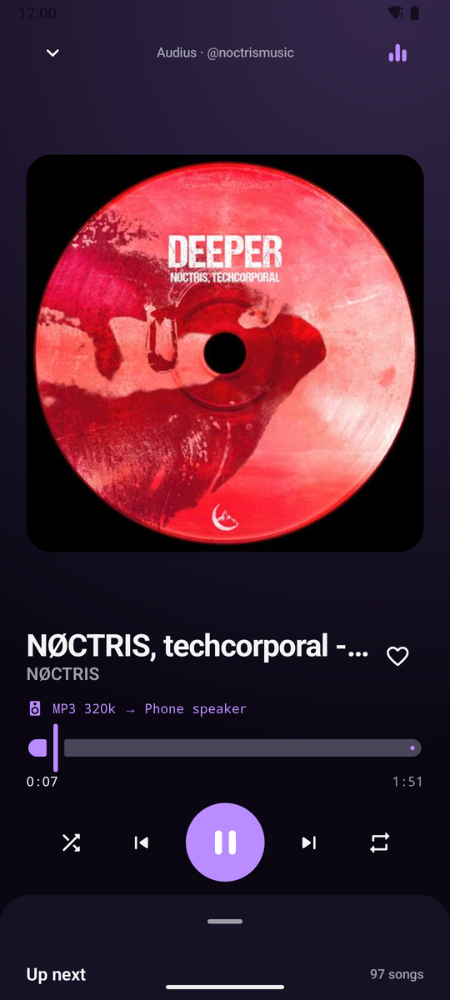
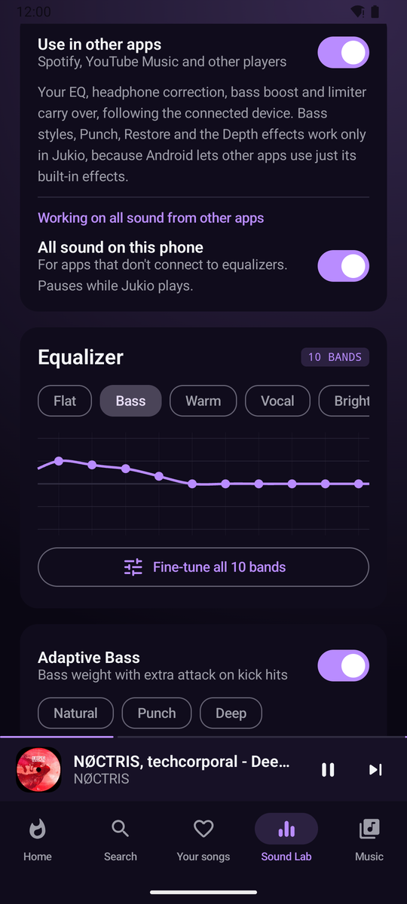
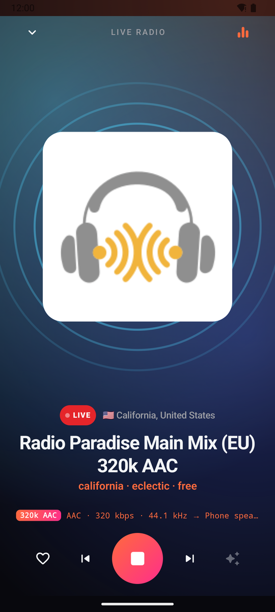
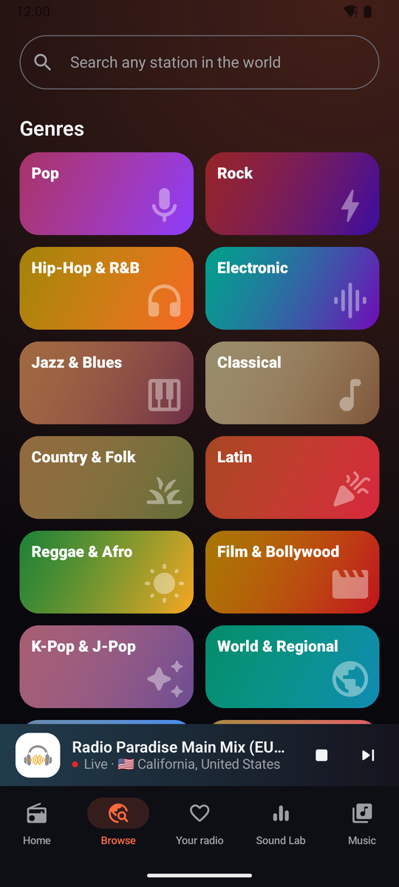

# Jukio Player

**A free Android music player that's all about sound.**
Your own music, live radio from 200+ countries and free songs from independent artists,
all shaped by **Sound Lab**: a 10-band EQ, adaptive bass, headphone correction and more.

[**⬇ Download the latest APK**](https://github.com/Voxsama/jukio-player-releases/releases/latest)

  
  
  

  
  
  

## What's inside

### 🎚️ Sound Lab
- **10-band equalizer** that hits the exact values you set, with presets or fine-tuning in 0.1 dB steps
- **Adaptive Bass** in three styles (Clean, Warm, Subwoofer), plus **Punch** for harder kick drums and **Restore** for deeper bass on small speakers
- **Headphone correction**: pick your headphones or earbuds and they're tuned to neutral, using measurements from [AutoEq](https://github.com/jaakkopasanen/AutoEq)
- **Depth**: Clarity, Fullness, stereo Width and room Ambience
- **Remembers settings for each device**: your earbuds, your car and the phone speaker each keep their own sound, switching automatically when you connect them
- **Works in other apps too**: your EQ, headphone correction, bass and limiter in Spotify, YouTube Music and other players (Android 9+)

### 🎵 Your music
- Finds the music on your phone automatically: albums, artists, genres, favourites
- **For You** mixes from what you play, all worked out on your phone
- **Volume leveling** so every song plays equally loud, **crossfade** (0–12 s) and gapless albums
- Themes, from Midnight and Aero glass to Retro vinyl, or make and share your own

### 📻 Radio
- **Live stations from 200+ countries**, sorted into genres, moods, decades, news & talk, countries and languages
- **Only good-sounding streams** (MP3 128k+, AAC 96k+); each station shows its quality, and Jukio checks the real stream when it plays
- Station of the day, stations near you, a new country every day, favourites

### 🔥 Free indie music (Audius)
- Songs uploaded by independent artists on [Audius](https://audius.co), streamed at **320 kbps**
- Trending charts, genres, rising artists, search and artist pages that link back to the artist

## Install

1. Download the `.apk` from the [latest release](https://github.com/Voxsama/jukio-player-releases/releases/latest) on your phone.
2. Open it. If Android asks, allow your browser or file manager to install apps.
3. That's it. Jukio tells you when an update is out and installs it for you.

**Prefer automatic updates from GitHub?** Add `https://github.com/Voxsama/jukio-player-releases` in [Obtainium](https://github.com/ImranR98/Obtainium).

## Privacy

No account, no ads, no tracking. Your library, favourites and listening history stay on your phone.
Jukio only goes online to check for updates, load radio stations and Audius songs, and download headphone
measurements you choose.

## Thanks

- Radio stations: [Radio Browser](https://www.radio-browser.info), the free community directory
- Independent music: [Audius](https://audius.co)
- Headphone measurements: [AutoEq](https://github.com/jaakkopasanen/AutoEq) (MIT)

**Found a bug or have an idea?** Open an [issue](https://github.com/Voxsama/jukio-player-releases/issues).
